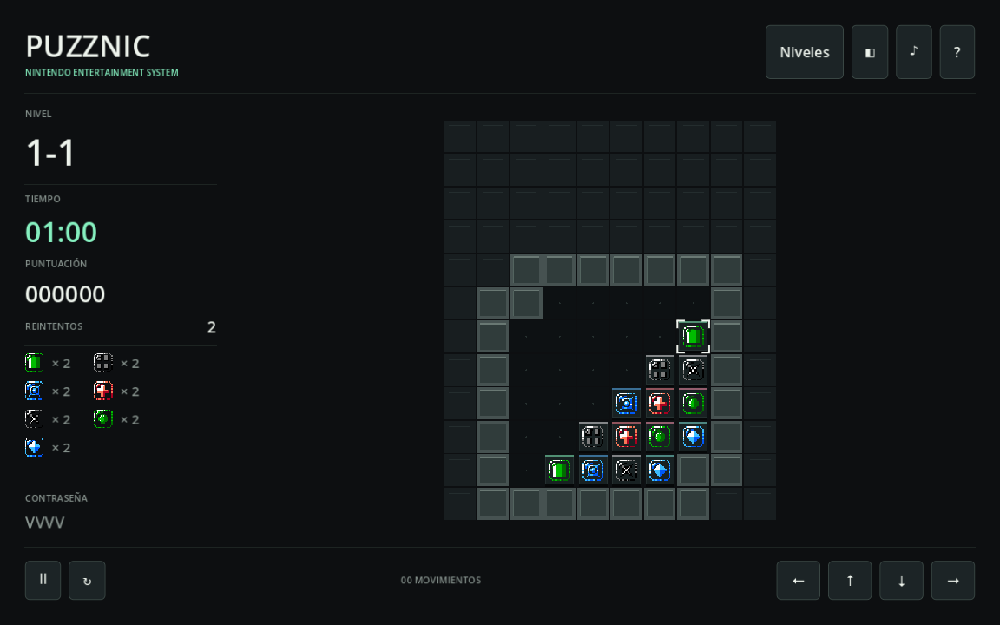

# Puzznic NES en Godot 4

Port nativo de las reglas de Puzznic, con los datos extraidos del cartucho
`Puzznic (USA).nes`. No ejecuta un emulador durante
el juego. El codigo de juego y la interfaz son GDScript.



Incluye los 160 niveles originales de Puzznic y los 80 de Gravnic, con una
interfaz moderna, controles de teclado y raton y progreso local.

## Abrir y jugar

Descargar la version de Mac desde [Releases](https://github.com/storo/puzznic/releases).
El ejecutable es universal, para Intel y Apple Silicon.

Para editar o ejecutar desde el codigo, clonar el repositorio, abrir
`project.godot` en Godot 4 y pulsar F5. La escena principal es
`scenes/main.tscn`. Verificado con Godot 4.7.1.

- Flechas: mover el cursor.
- Mantener Z, X, Espacio o Shift y pulsar izquierda/derecha: mover un bloque.
- Raton: seleccionar un bloque y arrastrar horizontalmente.
- Esc/Enter: pausa. R: reintentar. F11: pantalla completa.
- Gravnic, contrasenas y cambio de modo: menu de pausa.

## Datos originales

- 160 niveles de Puzznic, en orden 1-1 a 16-10.
- 80 niveles de Gravnic, en orden 1-1 a 8-10.
- Geometria, posiciones, tipos de bloques y plataformas, tiempos y contrasenas
  decodificados directamente de la ROM. Bonificaciones leidas de sus tablas.
- Simbolos originales extraidos de CHR. Musica de juego capturada de la ROM.
- Progreso local en `user://progress.cfg`.

La presentacion, particulas y efectos de acciones son nuevos. La musica normal
se reproduce como un segmento en bucle; las variantes de urgencia de la banda
sonora y los detalles de comportamiento por fotograma de NES no se han portado
de forma exacta. Las plataformas tienen movimiento continuo y transportan pilas.
Los 240 mapas se validan automaticamente; no se afirma haber completado todos
los niveles ni tener equivalencia exacta de todas las situaciones de NES.

## Verificar

```sh
godot --headless --editor --path . --import --quit
godot --headless --path . --script tests/test_engine.gd
godot --path . --script tests/test_game.gd -- --test
mkdir -p build
godot --headless --path . --export-release macOS "build/Puzznic NES.app"
```

En Mac, si Godot no esta en el PATH, sustituir `godot` por
`/Applications/Godot.app/Contents/MacOS/Godot`. La exportacion requiere instalar
las plantillas de exportacion correspondientes a la version del editor.

## Repetir la extraccion

La ROM no se incluye en el proyecto. El importador comprueba su SHA-256:
`5759d98edbb49cd9b2072dc74600cd73999c82e5f2d617e71d091e5fa8beea96`.

```sh
python3 -m venv .venv
.venv/bin/pip install -r tools/requirements.txt
.venv/bin/python tools/extract_nes.py "/ruta/Puzznic (USA).nes"
npm install --prefix tools
node tools/inspect_rom.mjs "/ruta/Puzznic (USA).nes" --music
```

`py65` ejecuta las rutinas del cartucho solamente para decodificar datos durante
la importacion. `jsnes` se usa solamente para obtener referencias visuales y
capturar audio durante desarrollo. Ninguno es dependencia del juego exportado.

## Licencia y creditos

El codigo nuevo de este proyecto se publica bajo [MIT](LICENSE).
Los datos y assets originales de Puzznic no estan cubiertos por esa licencia;
sus derechos pertenecen a sus titulares originales, Taito/IGS.
Ver [creditos y alcance de las licencias](THIRD_PARTY.md).
Este proyecto no esta afiliado a Taito, IGS ni Nintendo.
